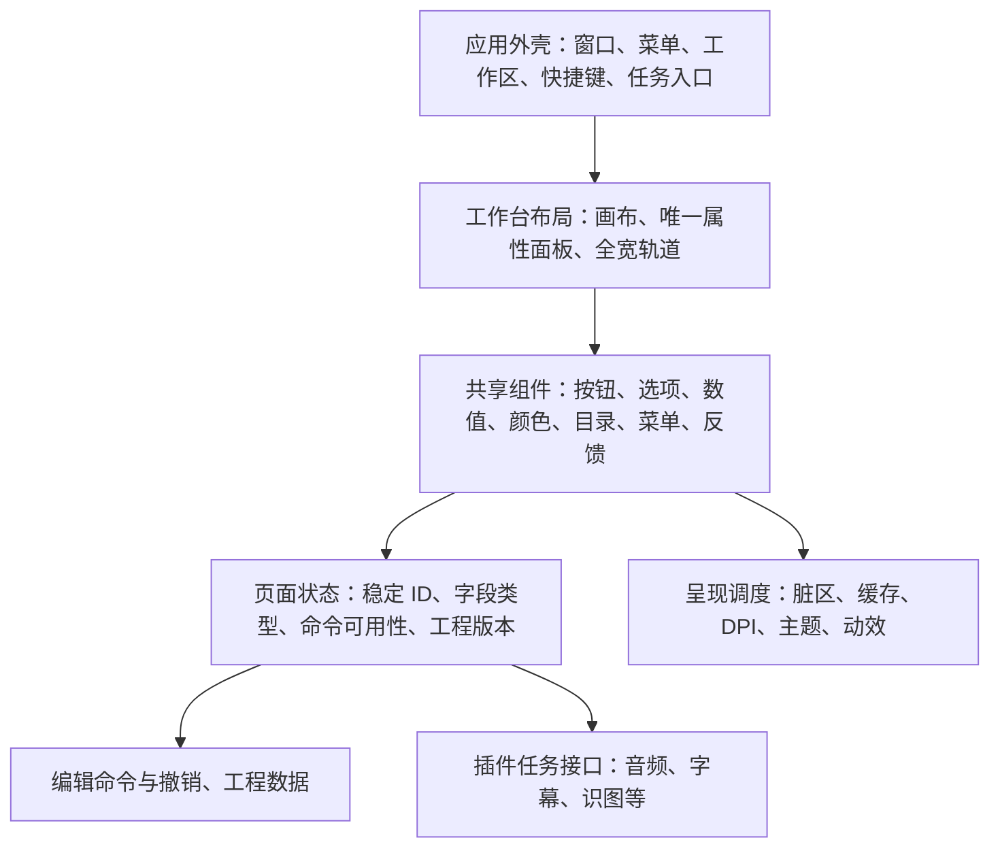

# Panzo 桌面 UI 商业化就绪审查

日期：2026-10-09。对象：**desktop-v12.6 发布版和匹配的源代码**。本轮为审查与基线测量，没有修改产品代码或生成新版安装包。

**结论：主工作流已经可用，尚不宜按“专业、流畅的商业桌面应用”验收。最需要优先解决的是大图窗口缩放性能、主要操作的可见性、浅色主题对比度和组件状态一致性。** 现有主题、控件和单一属性面板是可以继续发展的基础；下一步应统一组件与更新机制，再精修页面与动效。

后续实施见 [v13 逐项整改与验证记录](UI-Remediation-v13-2026-10-09.md)。本文件保留审查时的基线结果。

## 1. 审查边界与证据

- 发布程序：`target/desktop-v12.6/release/panzo.exe`。
- 源码指纹：`EAE1ECF49AAFEAE402C3829E9EA258390DE2A4CCD8F57C669DF276D944DA31D5`，审查前后均匹配候选。
- 程序 SHA-256：`7b0e8fdd53c7d61258ee260d6052622a471351742e27efd328bac642a034c135`。
- 本机：Windows 10 专业版 19045、i7-14700KF、28 个逻辑处理器、RTX 4080 SUPER，另有虚拟显示驱动。项目 README 声明 Windows 11 技术基线，因此这次结果不能代替 Windows 11 验收。[环境记录](acceptance/ui-commercial-audit-20261009/environment.json)
- 所有本轮运行测试使用独立配置和测试进程；图片为合成素材，视频为既有测试工程的副本。没有关闭用户现有进程、修改用户工程、录制麦克风或调用收费 AI 接口。
- 证据类型：**实测**是本轮发布版运行结果；**视觉**是已检查的有效窗口截图；**代码**是确定存在的实现；**风险**尚需专项复现；**缺口**表示未完成验收，不能等同于功能失败。

### 本轮结果

| 检查 | 结果 | 如何解读 |
|---|---|---|
| 三工作区、设置/插件独立窗口、设置草稿、目录编辑/取消、图片/素材预览、裁剪、跨工作区撤销路由 | 现有发布版回归脚本通过 | 证明脚本覆盖的流程可用，不代表每个功能都已商业验收 |
| 4000×2500 图片持续绘图 | 750 次移动；1397 次静止参考像素采样，0 次变化 | 本轮未复现采样可见的画布闪白；像素采样不是帧率，不能排除采样间的短暂闪烁 |
| 同一图片连续窗口缩放，首轮 80 次 | 中位数 63.32 ms；P95 70.78 ms；最大 120.24 ms | 有稳定、明显的处理开销 |
| 同一图片连续窗口缩放，复测 80 次 | 中位数 63.35 ms；P95 72.98 ms；最大 78.70 ms | 两轮共 160 次都超过 50 ms，值得列为首项性能整改 |
| 已预热的工作区切换，各 60 次 | P95 26.84 / 30.55 ms | 包含有图片的图片页、空视频页、素材页；不能外推到大型视频工程切换 |
| 视频窗口缩放，首轮 / 缓存复测，各 80 次 | P95 24.01 / 4.14 ms | 首轮同时存在冷缓存准备；复测复制了已有预览缓存，两个状态不能直接当优化前后对比 |
| 冷视频后台准备 | 无操作样本约占 1.89–1.96 个逻辑核 | 此时在生成代理缓存，不能标成“空闲持续高 CPU” |
| 视频缓存复测 | 预热样本约 0.31% / 0% 单核；改变尺寸后短时 20.31%；随后隐藏窗口 0% | 缩略图等后台工作会影响短时样本；当前没有证据支持持续空闲高占用 |

窗口缩放和切换的数值是跨进程 Win32 API / 消息往返时间，包含同步处理与系统调度；**不是实际显示帧率，也不是鼠标到屏幕呈现延迟**。测试脚本没有模拟完整的真实鼠标窗口拖拽消息循环。后续需要补充真实拖拽和呈现跟踪。

原始数据：[流程检查](acceptance/ui-commercial-audit-20261009/workflows/ui-smoke.json)、[绘图采样](acceptance/ui-commercial-audit-20261009/drawing/drawing-audit.json)、[响应首轮](acceptance/ui-commercial-audit-20261009/responsiveness/responsiveness.json)、[响应复测](acceptance/ui-commercial-audit-20261009/responsiveness-confirm/responsiveness.json)。

v12.6 已有的原生验收也应保留：四个属性标签共用一个宿主与左分隔线，面板底部跟随轨道分隔线，轨道保持全宽；深浅主题、收起恢复、声音属性及字幕修改撤销已有覆盖。[既有验收](acceptance/inspector-v12.6-20261009/review.txt)。这些不是本轮新执行的测试。

## 2. 按优先级整理的问题

### A01 · P1 · 大图调整窗口尺寸开销过高

**证据：实测 + 代码。** 两轮 P95 约 71–73 ms。图片显示缓存会因画布尺寸变化失效；失效路径从缓存深复制完整 `Raster`，4000×2500 BGRA 图片一次约 38.1 MiB，再生成显示尺寸位图。根工作区又同步重绘子窗口树。现有双缓冲与批量布局已经抑制闪烁，但仍有重采样、复制与过大重绘范围的开销。

位置：[图片绘制](../crates/panzo-windows/src/platform/picture_window.rs#L1293)、[根布局](../crates/panzo-windows/src/platform/workspace.rs#L503)、[批量布局](../crates/panzo-windows/src/platform/workspace_ui.rs#L129)。这些是已确认的昂贵路径，精确耗时占比仍需要剖析。

**整改：** 借用或共享只读图片缓存，避免尺寸变化时深复制原图；保留显示缓存与双缓冲；将布局提交、预览重采样和界面呈现合并调度，限定脏区域。连续调整尺寸时使用可控质量预览，结束后补清晰帧。不能通过取消必要重绘把闪屏问题带回来。

### A02 · P1 · 声音面板的主要动作被滚动内容挤出首屏

**证据：视觉 + 代码。** 在已有 1440×940 验收图中，声音页能看到设备与电平，但开始录制按钮已在可视范围下方。开始和结束录音使用同一位置，因此录音状态下的结束按钮也存在相同的布局风险。它们位于固定纵向坐标 `512 - 104` DIP，而属性面板高度会随轨道区域变化。

[有效截图](acceptance/inspector-v12.6-20261009/audio-dark.png) · [布局代码](../crates/panzo-windows/src/platform/media_panel.rs#L429)

**整改：** 四标签共用现有 Inspector 宿主；内部采用“固定操作区 + 可滚动参数区”。开始/结束录音、字幕应用/取消和任务进度应有稳定位置。最小高度时压缩电平展示与组间留白，高级属性滚动，主要动作仍可直接操作。删除和分割继续在轨道中完成。

### A03 · P1 · 浅色主题的部分文字对比度不足

**证据：代码 + 数值计算。** 普通状态文字直接使用下列颜色，白色面板上得到：

| 语义颜色 | 对比度 | 用途与处理 |
|---|---:|---|
| 主文字 | 15.005:1 | 保留 |
| 次级文字 | 6.161:1 | 保留 |
| 弱化文字 | 4.316:1 | 已保存等普通小文字需加深；禁用控件单独判断 |
| 错误文字 | 3.407:1 | 分离“错误文字色”与“装饰红色” |
| 警告文字 | 2.056:1 | 分离“警告文字色”与“图形填充色” |

灰底控件上这三类颜色还会更低。深色主题抽查的这些文字组合均超过 4.5:1。不要整体推翻用户认可的深色配色。

普通文字采用至少 4.5:1 的验收目标，并覆盖高对比度模式与文字放大。[Microsoft 无障碍检查清单](https://learn.microsoft.com/en-us/windows/apps/design/accessibility/accessibility-checklist)

[计算数据与公式](acceptance/ui-commercial-audit-20261009/token-audit.json) · [颜色定义](../crates/panzo-windows/src/platform/editor_ui.rs#L78) · [状态文字应用](../crates/panzo-windows/src/platform/editor_chrome.rs#L628)

### A04 · P1 · 插件操作未充分随选中项状态变化

**证据：视觉 + 代码。** 当前隔离配置只装有内置功能；选中已启用的离线 OCR 时，“启用”“回退上一版本”“卸载插件”仍展示为可操作按钮。卸载内置功能会在动作执行后才返回“内置功能可停用”。这让用户通过试错认识限制。

[有效插件截图](acceptance/ui-commercial-audit-20261009/management/plugins-dark.png) · [插件操作分派](../crates/panzo-windows/src/platform/plugin_manager.rs#L165)

**整改：** 根据内置/独立、启用状态、是否存在可回退版本和是否有正在使用的任务统一计算命令状态。主操作清晰；危险或低频操作放入合适的次级位置；不可执行的动作禁用，并提供原因。插件列表仍作为独立弹窗。

截图中的“0 个独立插件”来自专用空配置，不代表用户本机已安装的声音插件丢失。

### A05 · P1 · 面板隐藏后的任务可感知性需要补齐

**证据：代码 + 风险。** 媒体面板隐藏后任务继续运行，这是合理行为；录音时长、电平、结束和任务反馈主要在面板内部。切到画面/视频标签后，需要有统一、可返回操作的任务状态，而不是让后台任务存在于不可见界面中。本轮未开启真实麦克风或 AI 请求，不能宣称已经复现录音无法结束。

[隐藏面板宿主](../crates/panzo-windows/src/platform/inspector_host.rs) · [媒体轮询与反馈](../crates/panzo-windows/src/platform/media_panel.rs#L848)

**整改：** 主工作台保留轻量任务状态入口，点击回到对应面板；正在录音有可访问的结束动作。服务错误就地反馈，重试/取消/保留草稿行为一致。已保存状态继续位于折叠按钮之后，不另占轨道底部。

### A06 · P1 · 目标系统与商业验收矩阵不完整

**证据：缺口。** 当前测试机为 Windows 10，README 声明 Windows 11。单机、单次 DPI 和自动化消息测试不能证明 Win11 系统标题栏、125%/150%/200% DPI、多显示器、中文输入法、长时间运行都达到交付要求。

**整改：** 明确正式支持系统。如果继续采用 Win11 基线，发布门槛必须包含真实 Win11；如果也支持 Win10，需要明列为支持项并验证回退标题栏。至少覆盖最小窗口、最大化/还原、跨屏 DPI、输入法候选窗、键盘操作、普通显卡与代表性低配设备。

### A07 · P2 · 信息层级与密度仍按页面各自安排

**证据：视觉 + 代码。** 设置页字段和按钮集中在上部，下半部大量闲置；长说明横贯内容区；主工作区空状态仍保留闲置的下方区域；素材列表与预览的空间、图片页的上下工具行缺少跨页面统一节奏。已有字体和尺寸定义，但大量局部高度与边距未形成完整组件规范。

[设置页](acceptance/ui-commercial-audit-20261009/workflows/settings-light.png) · [图片页](acceptance/ui-commercial-audit-20261009/workflows/image-dark.png) · [素材页](acceptance/ui-commercial-audit-20261009/workflows/assets-dark.png) · [空状态](acceptance/ui-commercial-audit-20261009/workflows/workspace-dark-empty.png)

**整改：** 确立文字、图标、控件和分组层级；设置内容限制合适行宽，按含义分组，并根据内容确定初始窗口尺寸。低频说明按需出现；空状态只保留入口和必要说明。图标按钮保留悬浮提示与键盘名称，符合此前约定的纯图标工具栏。

### A08 · P1 · 表单类型与业务状态存在隐式耦合

**证据：代码，属于架构风险。** `workspace_form` 根据中文标签是否包含“文件夹”“边”“秒”等以及当前字符串能否解析为数字，推断控件和预设；部分复用策略也比较中文标题。改一个文案可能改变控件行为。根工作区、图片编辑器、视频编辑器与媒体面板还分别承担状态、布局和任务协调。

[字段生成](../crates/panzo-windows/src/platform/workspace_form.rs#L159) · [数字预设](../crates/panzo-windows/src/platform/workspace_form.rs#L390) · [设置导航](../crates/panzo-windows/src/platform/management_window.rs#L164)

**整改：** 引入带稳定 ID 的字段、命令、页面描述；数字字段显式声明单位、范围、步长、预设与校验，目录、密钥、颜色和选项各有类型。文案只负责显示。沿用现有 Inspector 唯一布局，不新增第二套侧栏。

### A09 · P2 · 应用确认与错误窗口仍有两种表现路径

**证据：代码。** 自绘 `app_menu` 已被多处使用，但关闭图片、部分错误、卸载插件等仍直接调用 `MessageBoxW`。它们会受系统版本影响，与已自绘的界面状态和主题反馈不完全一致。本轮未逐个打开确认窗口，不能把所有窗口都标成已目视复现。

位置：[关闭图片](../crates/panzo-windows/src/platform/picture_window.rs#L1755)、[卸载插件](../crates/panzo-windows/src/platform/plugin_manager.rs#L187)、[识图反馈](../crates/panzo-windows/src/platform/vision_ui.rs)。

**整改：** 应用级确认与错误使用统一的标题、正文、主次按钮、焦点和主题样式。文件/目录选择继续使用系统选择器；它们是桌面平台交互的一部分。

### A10 · P2 · 缺少统一、可关闭的动效规则

**证据：代码。** 共享按钮悬浮状态直接切换并重绘；工作区和面板显示也直接切换。在 UI 源码中未找到集中动效调度、缓动定义或 Windows 减少动画偏好的接入。系统自身的弹窗动画不在此结论内。

[按钮状态](../crates/panzo-windows/src/platform/desktop_ui.rs#L478) · [工作区切换](../crates/panzo-windows/src/platform/workspace.rs#L490)

**整改建议：** 悬浮/按压约 80–120 ms；面板/轻量状态过渡约 160–200 ms；使用明确的进入/退出缓动，并跟随系统动画偏好。窗口拖拽、时间线定位、裁剪手柄、绘画和播放跟随必须即时响应，不增加追赶动画。上述时长是设计建议，需在实际程序中调校；微软的动效指导提供一致时长和进入/退出缓动的参考。[Timing and easing](https://learn.microsoft.com/en-us/windows/apps/design/motion/timing-and-easing)

### A11 · P1 · 无障碍基础存在，系统偏好与完整操作验收仍不足

**证据：代码 + 缺口。** 编辑器有 UI Automation、自定义控件可访问名称和键盘处理，标准控件也保留原生行为，因此不能说“没有无障碍支持”。但未找到对系统高对比度、独立文字缩放和减少动画偏好的统一处理；目前没有全工作区读屏及纯键盘验收证据。

[现有无障碍实现](../crates/panzo-windows/src/platform/accessibility.rs) · [共享字体/DPI](../crates/panzo-windows/src/platform/editor_ui.rs#L1421)

**整改：** 补齐系统偏好与可见焦点规则。对自绘轨道、分隔线、颜色面板和菜单验证可访问名称、状态及操作。焦点标识只在需要时显示，使用克制的实体标记，不使用输入/输出框发光边缘。[Microsoft 检查清单](https://learn.microsoft.com/en-us/windows/apps/design/accessibility/accessibility-checklist)

### A12 · P2 · 后台更新策略需要基于状态变化和可见性收敛

**证据：代码 + 风险。** 根工作区 100 ms 轮询；媒体面板 120 ms 轮询，空闲时读取并复制工程设置和编辑数据，录音电平还从文件读取。它们目前不等于已证实的持续高 CPU，但工程规模、面板数量和动效增加后会扩大开销。视频绘制还会按脏区创建临时 GDI 位图；图片已有可复用帧缓冲，不能误写成“所有页面每帧都重新分配”。

[媒体快照](../crates/panzo-windows/src/platform/preview_window.rs#L7446) · [视频绘制](../crates/panzo-windows/src/platform/preview_window.rs#L4645)

**整改：** 工程 revision/事件驱动视图更新，只读取所需投影；不可见面板暂停装饰更新，保留必要任务调度；后台完成事件通知 UI。统一帧调度、缓存生命周期与性能计数，先建立基线再逐项优化。

## 3. 建议保留并完善的架构

现有 Rust + Win32/GDI + D3D 路线可以继续使用。现有证据支持先修正边界、状态和渲染策略；没有足够依据启动全面 UI 框架迁移。



插件负责功能执行和能力声明；窗口、面板、主题、交互状态和任务反馈由宿主统一提供。已有媒体插件协议继续使用，不因视觉改造破坏现有插件。先把自带声音/字幕能力迁成共享组件的示范，再扩展插件 UI 描述协议。

## 4. 视觉与交互基线

| 项目 | 约定 |
|---|---|
| 整体气质 | 克制的桌面工具；保留当前深灰主题，浅色使用白色与合适的蓝色强调 |
| 布局 | 顶部菜单与系统按钮同一基线；三个工作区居中；右属性面板始终止于轨道上方；分隔线统一 |
| 间距 | 以 4/8 DIP 为基础，字段组内紧凑，分组间 16/24 DIP；由组件角色决定，不逐页随意取值 |
| 字体 | 正文以 14 DIP 为候选，次要信息 12/13 DIP、组标题 15/16 DIP；在系统文字放大时重新布局 |
| 图标 | 统一线宽、视觉尺寸与居中方式；典型图标 16–18 DIP，常用命中区 32 DIP；专业编辑手柄另行定义 |
| 状态 | 普通、悬浮、按压、选中、禁用、键盘焦点、忙碌、错误均有一致表现；选中与悬浮可区分 |
| 表单 | 数值明确单位与合法范围，同时支持输入和预设；目录用图标与路径，编辑时出现输入框 |
| 主要操作 | 固定在面板可见区；未准备好时禁用并解释原因；不依赖滚动到底部寻找 |
| 反馈 | 用户可处理的信息就地显示，必要时提供重试/取消；技术详情按需展开；不常驻开发诊断内容 |
| 图像/视频 | 编辑手势直接跟随；缩放、平移、居中适配有统一可发现入口；保持用户已经确认的手势约定 |
| 动效 | 服务于状态变化与方向感；不拖慢高频编辑；系统关闭动画时立即切换 |

不引入大面积装饰卡片、渐变背景或输出框亮边。先制作真实原生组件的状态样例，再迁移页面，验收使用运行中的 EXE。

## 5. 整改顺序与完成标准

| 顺序 | 工作包 | 完成标准 |
|---|---|---|
| 1 | 性能与状态基础：A01、A08、A12 | 定位大图重采样/复制耗时；布局一次提交；类型化字段/命令；工程变化驱动更新；新增与本轮相同的测量对照 |
| 2 | 共享组件：A03、A04、A09、A11 | 深浅色完整状态表；普通文字对比度达标；菜单/弹窗/下拉/滚动条/数值/颜色/目录交互一致；键盘与读屏覆盖 |
| 3 | 页面收敛：A02、A05、A07 | 声音/字幕主要操作无需滚动查找；任务切换后可见可返回；设置与素材密度合理；清除无内容的占位区域 |
| 4 | 动效：A10 | 接入统一时钟与系统偏好；小范围状态过渡平顺；编辑手势无附加延迟 |
| 5 | 发布验收：A06 | Win11、DPI、窗口尺寸、输入法、设备与性能矩阵完成；截图、二进制和源码指纹一致；未通过项公开记录 |

建议性能门槛需先在明确的参考设备上确认，以下是**目标，不是当前已经达成的结果**：

- 与本轮相同的大图窗口尺寸探针，P95 先降到 16.7 ms 以内，常规样本不出现超过 50 ms 的停顿；真实鼠标拖拽再用呈现跟踪确认，不能把消息耗时当成 60 FPS。
- 高频编辑手势不在 UI 线程执行文件读写、网络请求或整图深复制；耗时任务在 100 ms 内给出可感知反馈。
- 代理/缩略图等准备任务完成且无播放、录制、导出时，建立 30 秒空闲 CPU、内存和 GDI 对象基线；打开关闭面板 100 次没有持续增长。
- 100% / 125% / 150% / 200% DPI、最小尺寸和最大化下，主要操作始终可访问；无控件遮挡、截断按钮、轨道与侧栏重叠。
- 所有图标按钮有提示、名称和键盘入口；菜单可通过键盘打开/选择/退出；文本编辑快捷键不误触发工作区命令。
- 网络断开、429、设备拔出、插件停用、任务取消、工程关闭都保留可理解的状态与恢复路径；使用模拟服务和测试设备验证，另行完成真实服务兼容性验收。

## 6. 还未覆盖的项目

本轮没有重新执行真实区域录制、系统声音与麦克风采集、真实 AI 字幕/识图服务、完整导出编解码矩阵、长项目压力、混合 DPI 跨屏、全流程 Narrator 或低端设备测试。拼图、托盘菜单、颜色面板等已改造模块本轮以代码审阅和已有证据为主，没有把历史测试自动计作本轮通过。

自动化窗口截图也需验证实际目标窗口没有被同进程其他窗口遮挡：本轮发现两份既有采集路径中的插件截图无效，已剔除出视觉结论；重新取得的 `management/plugins-dark.png` 有目标窗口命中记录。测试脚本通过与截图可用于视觉验收是两个独立条件。

## 7. 复现入口

```powershell
python scripts/test-ui-repair-release.py --binary target/desktop-v12.6/release/panzo.exe --output docs/acceptance/ui-commercial-audit-20261009/workflows
python scripts/test-drawing-stability.py --binary target/desktop-v12.6/release/panzo.exe --output docs/acceptance/ui-commercial-audit-20261009/drawing
python scripts/audit-ui-responsiveness.py --binary target/desktop-v12.6/release/panzo.exe --output docs/acceptance/ui-commercial-audit-20261009/responsiveness-image --phase image
```

视频探针另传 `--fixture-project <测试工程目录>`，先复制到独立目录；`--include-cache` 复制已有缓存用于暖态测量。屏幕截图与像素采样要求测试窗口不被遮挡。数据应保存到新的输出目录以保留前后基线。
